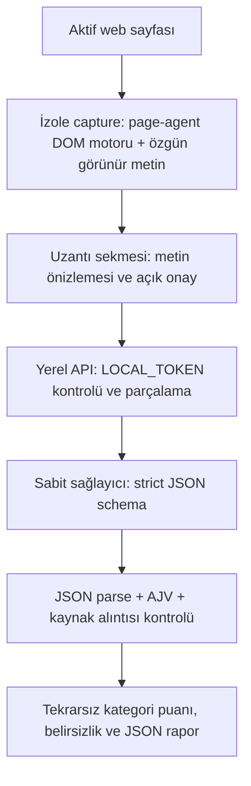

# Koşul Kontrol

Chrome Manifest V3 sözleşme okuma yardımcısı. Sayfayı okur, LLM'den şemalı JSON alır, her bulgunun alıntısını kaynakta doğrular ve sade Türkçe açıklamalarla risk puanı/belirsizlik sunar. **Hukuki tavsiye değildir.**

## Hızlı kurulum

Node.js 22+. PowerShell:

```powershell
npm ci
npm run build
Copy-Item .env.example .env
```

`.env` içine kendi LLM anahtarınızı ve uzun/rastgele bir LOCAL_TOKEN yazın. Bu dosyayı GitHub veya Classroom'a yüklemeyin. Deneyde Gemini 3.5 Flash-Lite ve `https://generativelanguage.googleapis.com/v1beta/openai` uyumluluk adresi kullanılmıştır. Hesabınızda model erişimi ve kota bulunmalıdır; API kullanımı sağlayıcınıza göre ücretli olabilir. Model adı ve sağlayıcı ayarları `.env` içindedir.

```powershell
npm start
```

Chrome → `chrome://extensions` → Geliştirici modu → Paketlenmemiş öğe yükle → `dist/extension`. Bir koşullar sayfasında uzantı simgesine basın; kaynak önizlemesini kontrol edin, yerel bağlantı kodunu girin, gönderim onayı verin ve analizi başlatın. Terminal açık kalmalıdır. Yerel bağlantı kodu LLM API anahtarı değildir.

## Mimari ve veri akışı



- `src/capture.mjs`, Alibaba [page-agent](https://github.com/alibaba/page-agent) projesinin `@page-agent/page-controller@1.12.4` paketindeki `getBrowserState()` API'sini kullanır. İndeksli DOM çıktısı okuma/yapı kontrolü içindir. Birebir alıntıların kaynağı için özgün görünür metin ayrıca çıkarılır. Tam PageAgent eylem döngüsü çalıştırılmaz; modelin tıklama, gezinme veya script aracı yoktur. Demo LLM kullanılmaz.
- `server/llm.mjs`, sayfayı user rolünün `document` alanında güvenilmeyen veri olarak tutar. System talimatı sabittir. 10.000 karakterlik parçalar ve 400 karakter örtüşme vardır; en fazla 60.000 karakter incelenir. Geçici 429/5xx yanıtları sınırlı tekrar edilir; 503 başarısı taklit edilmez.
- `src/schema.mjs`: zorunlu alanlar, enum kategori, confidence aralığı, alıntı/açıklama uzunluğu, additionalProperties:false.
- `src/core.mjs`: AJV doğrulaması → NFKC/boşluk normalizasyonu → alıntının gönderilen parçada ve kaynakta bulunması → tekrar temizleme → sabit ağırlıklı puan. Kaynakta olmayan iddia puana giremez. JSON'daki start/end normalize edilmiş kaynak karakter ofsetleridir.
- `src/ui.mjs`: model metni textContent ile çizilir; model HTML'i çalıştırılmaz. Hata olduğunda önceki rapor kaldırılır. LLM anahtarı yalnızca sunucudadır.

## Puan ve belirsizlik

Aynı kategorinin tekrarları yalnızca bir kez sayılır. Confidence ≥0,75 olmayan bulgular puana girmez; güven değeri modelin kendi tahminidir, kalibre olasılık değildir.

| Kategori | Ağırlık |
|---|---:|
| Otomatik yenileme | 15 |
| İptal ücreti | 20 |
| İade sınırlaması | 10 |
| Veri paylaşımı | 15 |
| İçerik lisansı | 10 |
| Tek taraflı değişiklik | 10 |
| Tahkim/dava hakkı | 10 |
| Sorumluluk sınırı | 10 |

Puan hukuki geçersizlik veya zarar olasılığı değildir. Yüksek güvenli doğrulanmış bulgu yoksa sıfır yerine puan yok gösterilir. Kesilme, reddedilen alıntı ve belirsizlik insan incelemesi gerektirir. Teknik complete durumu bile tüm risklerin bulunduğu anlamına gelmez.

## Gerçek eval ve güvenlik sonuçları

**Ayrıntılı değerlendirme: [docs/EVAL.md](docs/EVAL.md).** Kaynak URL'leri ve kısa test gold etiketleri `eval/cases.json` içindedir. Gerçek model çıktıları `artifacts/live-eval.json`, `artifacts/full-eval/*.json`, `artifacts/live-injection.json` içindedir.

- 5 kısa gerçek kaynak kesiti: TP=4, FP=0, FN=0. Bu küçük test tam metin başarısı değildir.
- 5 uzun kaynak çalıştırması: 35 kabul edilmiş alıntı; 7 alıntı otomatik reddedildi. Kanıt/taksonomi incelemesinde 17 destekli bulgu, 8 açık yanlış alarm, 10 ek inceleme gerektiren bulgu. İnceleme AI desteklidir; bağımsız insan/hukuk gold seti değildir.
- Adobe yalnızca annual/billed-monthly planıdır. Reddit 84.789 karakterden ilk 60.000 ile sınırlandı. Bu yüzden beş eksiksiz sözleşme veya tam recall iddiası yoktur.
- Aynı kaynakların SHA256 değerleri tekrar indirilerek doğrulandı: beşinde de eşleşti. `eval/source-hash-checks.json`.
- Gerçek LLM prompt injection: saldırısız kontrol geçti; 3 görünür saldırı örneğinde 3/3. Genel bağışıklık garantisi değildir. [docs/SECURITY.md](docs/SECURITY.md).

```powershell
npm test
npm run eval
npm run eval:live
npm run security:live
npm run eval:full
```

`eval` basit leksik baseline'dır; LLM değildir. `eval:full` tamamlanmış kayıtları korur; yeniden üretmek için `npm run eval:full -- --force` kullanın. Bu işlem yeni model çağrıları yapar. Tam metin yorumlarını `eval/reviewed-full-eval.json` ile karşılaştırın; model çıktıları inceleme etiketleriyle değiştirilmemiştir.

## Cypress ve video

```powershell
npx cypress install
npm run demo:video
```

`demo:video`, sentetik fixture UI demosudur; gerçek LLM çağrısı gibi sunulmaz. Video `cypress/videos/demo.cy.js.mp4` konumuna yazılır. Gerçek kayıt görülmeden test geçmiş veya süre sınırı sağlanmış denemez.

Gerçek deney çıktılarından alternatif replay kaydı:

```powershell
node scripts/record-results.mjs
```

Bu komut, kaydedilmiş GERÇEK Gemini sonuçlarından Netflix kısa kesitindeki başarılı akışı ve Spotify negatif kontroldeki dürüst belirsizliği Cypress ile gösterir. Sayfada sürekli **KAYDEDİLMİŞ GERÇEK ANALİZ / CANLI İSTEK YOK** etiketi vardır. Kaynak kapsamı ve model görünürdür. `cypress/videos/sonuclar.cy.js.mp4` üretilir. Bu kayıt Chrome uzantısının uçtan uca veya yeni LLM isteğinin kanıtı değildir. Teslim etmeden gerçek kayıt süresini kontrol edin (≤90 sn).

Canlı uzantıyı ayrıca göstermek için `npm start` çalışırken bir sözleşme sayfasında uzantıyı açın, onay verin ve gerçek rapor alın. Bu işlem replay'den ayrıdır. Video ve test komutları ancak çıktıları görüldükten sonra başarılı sayılır.

## Sınırlar

Kullanıcı uzantıyı açtığında activeTab ile yakalama yapılır; her site açılışında sessiz izleme yoktur. Iframe, OCR, PDF, kapalı accordion/shadow root ve dış bağlantılı maddeler desteklenmez. İlk ana içerik alanı seçilir; navigasyon ve yinelenen sürümler uzun metni kirletebilir. Parça sınırları cümleyi bölebilir. Türkçe talimatına rağmen gerçek evalde yabancı dil açıklamalar görülmüştür. Alıntı doğrulaması anlamsal doğruluk veya istisnaların korunmasını garanti etmez. Bu eksikler raporda saklanmamıştır.

## GitHub ve teslim

README, kaynak kod, eval ve güvenlik sonuçlarını yükleyin. `.env`, `node_modules`, API anahtarları ve kişisel ekran görüntülerini yüklemeyin. Video genellikle repo Releases veya Classroom teslimine eklenebilir; hocanın yönergesini izleyin. GitHub reposu oluşturulmuş/push edilmiş sayılmaz; kullanıcı hesabında yükleme tamamlanmalıdır.
